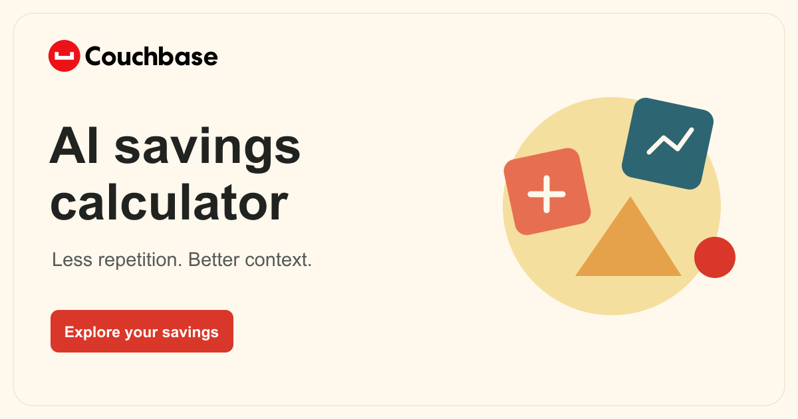

# AI Savings Calculator

Explore how caching and shorter prompts could change a team's model costs.

[Open the demo](https://couchbase-ai-savings.vercel.app/) · [All demos](https://couchbase-demo-library.vercel.app/)

## Start here

- Enter monthly model spend or a dedicated GPU setup.
- Choose the workload patterns that apply.
- Review the annual estimate and adjust assumptions if needed.

## What it uses

- Input and output costs are calculated separately.
- Savings are estimates, not measured results or a complete return-on-investment calculation.
- Sources and assumptions are available in [Methodology](methodology.html).

## Run locally

Open `index.html` in a browser. No build step is needed.

Run the calculation checks with `node --test tests/*.test.cjs`.

## Details and feedback

- [Technical reference and original documentation](README-REFERENCE.md)
- [Couchbase Design and UI Pattern Repair](https://github.com/john-couchbase/agent-skills)
- [Couchbase setup skill](https://github.com/john-couchbase/couchbase-aidp-setup)

When reporting an issue, include the request or input, what you expected, and a screenshot. Mention whether you used a phone, tablet, or computer.
